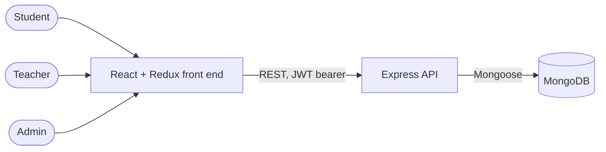

# E-learning Platform (MERN): High-Level Design

A full-stack e-learning platform with three roles: students browse and enroll in courses and watch videos, teachers create courses and upload video lessons, and admins manage users, courses, videos and settings. Live at [elearning-platform-using-mern.vercel.app](https://elearning-platform-using-mern.vercel.app). For code-level detail see the [Low-Level Design](lld.md). Project reports and test documents are in the [`Docs/`](.) folder.

## 1. Context

## 2. Areas

| Role | Front-end routes | Can |
|---|---|---|
| Student | `/`, `/course/:id`, payment page, `/Teachme` | Browse, enroll (mock checkout), watch videos |
| Teacher | `/TeacherDashboard`, `/Teacher/courses`, `/Teacher/addCourse`, `/Teacher/videos`, `/Teacher/videos/add/:courseId`, `/Teacher/edit/:id` | Manage own courses and videos |
| Admin | `/admin/dashboard`, `/admin/users`, `/admin/courses`, `/admin/videos`, `/admin/discount`, `/admin/giftcard`, `/admin/statistic`, `/admin/setting` | Manage everything |

## 3. Tech

| Layer | Choice |
|---|---|
| Front end | React (Create React App), Redux, React Router, axios |
| Back end | Node.js, Express, Mongoose |
| Auth | bcrypt passwords, JWT access token (7 days) + refresh token (24 days), logout blacklist |
| Hosting | Vercel (with Vercel Analytics and Speed Insights) |
