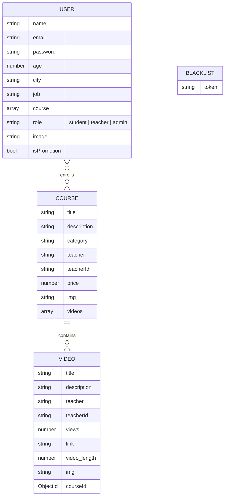
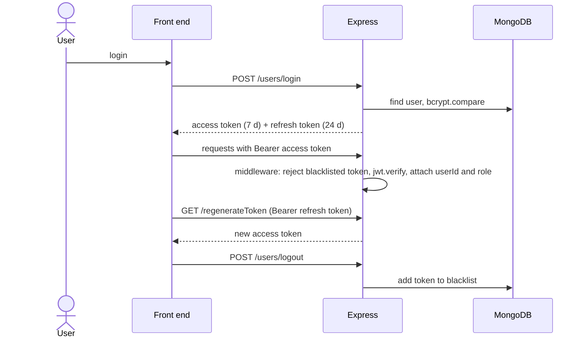

# E-learning Platform (MERN): Low-Level Design

For the big picture see the [High-Level Design](hld.md).

## 1. Models

## 2. API

| Router | Routes |
|---|---|
| `/users` | `GET /`, `POST /register`, `POST /login`, `PATCH /update/:userId`, `DELETE /delete/:userId`, `POST /logout`, `GET /userCourse/:userId`, `POST /addCourse/:courseId`, `GET /Teachme/:userId` |
| `/courses` | `GET /all`, `GET /`, `GET /TeacherCourses`, `GET /:courseID`, `POST /add`, `PATCH /update/:courseID`, `DELETE /delete/:courseID` |
| `/videos` | `GET /`, `GET /:videoID`, `POST /add/:courseId`, `GET /courseVideos/:courseId` |
| root | `GET /regenerateToken` (refresh → new access token) |

## 3. Auth flow

## 4. Enrollment

The payment page shows a card form, then calls `POST /users/addCourse/:courseId`, which adds the course to the user's list. No payment provider is connected, so it works as a mock checkout.

## 5. Known issues

| Issue | Risk | Fix |
|---|---|---|
| JWT signing secrets are hard-coded string literals in the source | Anyone who reads the public repo can forge tokens for any user or role | Move them to environment variables and rotate them |
| Access and refresh tokens use different secrets in different files | Easy to break one path when changing the other | One config module for both |
| Blacklist is checked from an in-memory list and the database | Can disagree after restarts | Check only the database (or use short-lived tokens) |
